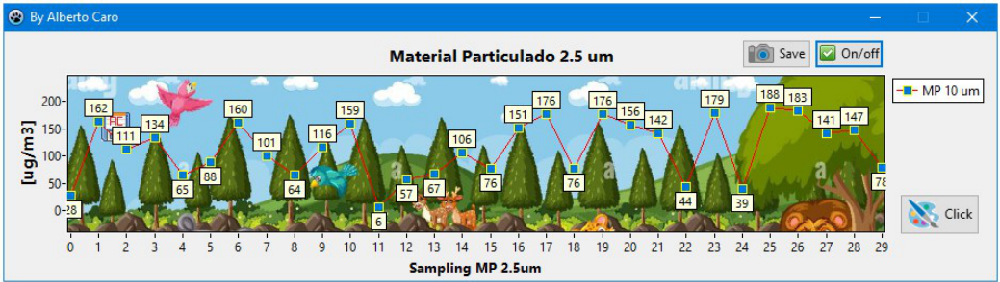
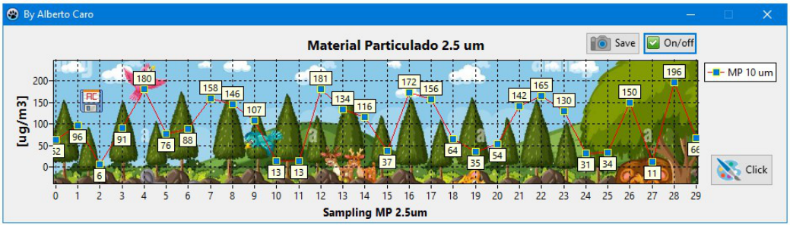
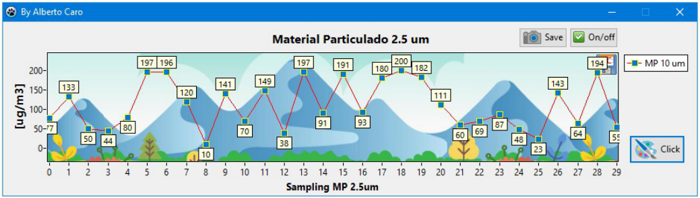

1.- En este proyecto usted deberá investigar sobre el desarrollo de un visor de **Material Particulado MP 2.5 um** utilizando **Lazarus Free Pascal** con generación de código compilado. La interfaces deben ser similar a las siguientes figuras: 

## **Observaciones:** 

1. Se utiliza el componente serial LazSerial el cual se puede buscar e instalar desde el **IDE** de Lazarus (Opción Paquete → **Online Package Manager**) 

2. Los datos se reciben desde un script de **python** a **9.600 Bps, 8N1** a un sampling de **1** segundo.
3. El rango de los valores de **MP2.5** um se modela con una **Distribución Normal(80,5)** . 
4. En la interfaz presentada el botón “ **Cámara Fotográfica** “ → realiza una captura → **captura.png** . 

5. El botón “ **On/Off** ” → Activa/Desactiva la **Grilla** del visor. 

6. El botón de “ **Click** ” → Cambia la figura de fondo ( **background** ) del visor. 

7. La interfaz debe poseer: **Título principal** (Top), **SubTítulo** (Bottom) y con activación en cada botón de la propiedad **Hint** . 

8. Se debe utilizar el componente **TChart** el cual incluye la serie de tipo **TLinesSeries** . 

9. Deberá configurar las propiedades de **_Legend, LinePen, Marks, Frame, LabelBrush, Style, Pointer, SeriesColor, etc_** . 

10. La interfaz debe enviar el **MP25** recibido a un **Server TCP/IP Lazarus Pascal mode consola** que almacene los datos en **SQLITE Tabla Aire** con **Fecha y Hora** . Los datos recibidos se deben mostrar también por consola. 

11. Utilice **HeidiSQL_12.3_64_Portable** para crear la base de datos y ver la data recibida en tiempo real.

12. Hay una carpeta "./images" en la que se almacenan las imagenes que se utilizaran en este proyecto.

13. Utiliza codigo con variables que sean entendibles.

14. Prefiere codigo extenso pero mas sencillo de leer, antes que comprimir el codigo en pocas lineas de codigo resultando mas complejo de leer, esto dependiendo de si es logica corta y entendible (no hay necesidad de extender) a logica larga pero que acortastes ().