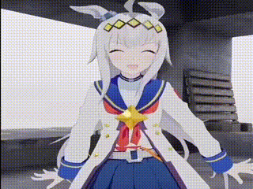

# Proyecto #3 (Unidad III)

## Este proyecto utiliza las siguiente tecnologias:
### Lazarus Free Pascal
###### Junto a su componente (paquete) descargable "LazSerial"

### SQLite
### HeidiSQL v12.3 x64 Portable

  

---